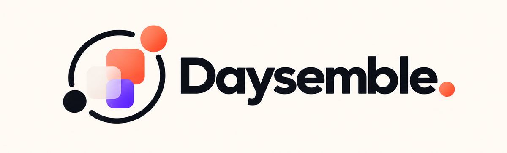
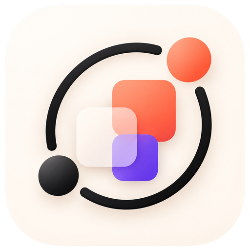
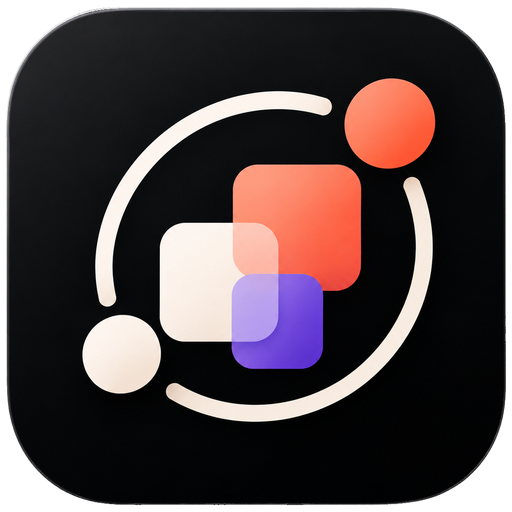
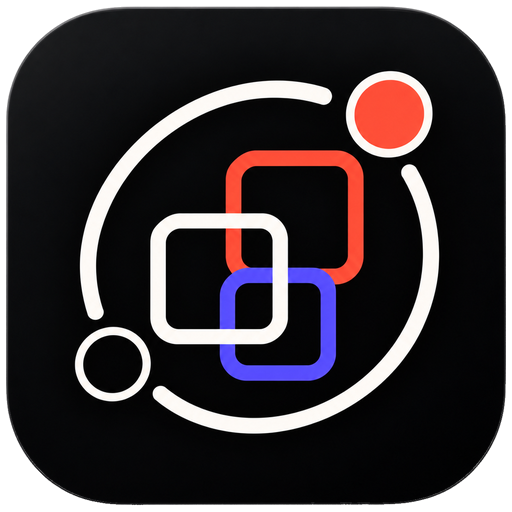
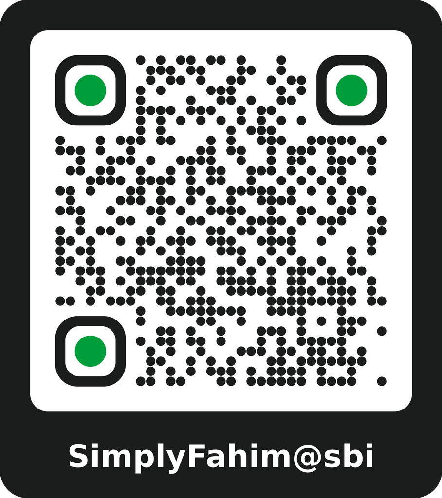

<div align="center">



**An Android planner for events, tasks and reminders, with optional two-way sync with Google Calendar and Google Tasks.**

[](#development-status)
[](#build-from-source)
[](#technology-stack)
[](LICENSE)

[Features](#features) · [Build](#build-from-source) · [Privacy](#permissions-and-privacy) · [Status](#development-status) · [Credits](#acknowledgements) · [Support](#support-development)

</div>

---

## About

Daysemble puts your calendar, your to-do list and your reminders in one Android app. The Today
screen shows the day's events and tasks on one timeline, tells you when you're free, and counts down
to what's next.

Everything is stored on the phone first. The app works fully offline and without an account. If you
connect a Google account, events and tasks sync both ways with Google Calendar and Google Tasks.
Edits made offline are queued and sent later. There is no Daysemble server, no analytics and no ads.

A few implementation choices shape the app:

- **Time zones and DST.** Times are stored as UTC instants plus an IANA time zone, and repeating
  events expand in their own zone, so a 09:00 meeting stays at 09:00 across daylight-saving changes.
- **Reminders that survive the system.** Reminders use exact alarms where Android allows them, fall
  back to inexact alarms otherwise, are re-planned after reboots, clock and time-zone changes, and
  are never posted twice.
- **Narrow Google access.** The app requests event access and a read-only calendar list instead of
  full calendar access, holds tokens in memory only, and never deletes anything from Google on
  disconnect.

## Development status

> [!IMPORTANT]
> Daysemble is in **early development (version 0.1.0)**. There are no published releases yet; build
> it from source to try it.

What is verified today:

- The project has 415 JVM and [Robolectric](https://robolectric.org/) test cases, including Compose
  tests that render every main screen with data in both themes and at 2× font size.
- On `main`, CI builds the debug and R8 release APKs, runs the unit tests and lint, audits the release
  APK, and launches it on an API 35 emulator to check it doesn't crash.
- Google sync is tested against a mock server ([MockWebServer](https://github.com/square/okhttp/tree/master/mockwebserver)), not live Google.

Not verified yet: real-device look and feel, TalkBack, the exact-alarm permission flow and live
Google sign-in. See [Verification status](#verification-status) for the full table.

## Screenshots

There are no screenshots yet. This README will only show genuine captures of the running app, taken
with [`scripts/capture_screenshots.sh`](scripts/capture_screenshots.sh) and stored in
`docs/screenshots/`. Mock-ups and renders are not used in their place.

The app ships with three selectable logos, which also change the launcher icon:

<table>
  <tr>
    <td align="center"><br><sub><b>Classic</b> (default)</sub></td>
    <td align="center"><br><sub><b>Midnight</b></sub></td>
    <td align="center"><br><sub><b>Outline</b></sub></td>
  </tr>
</table>

## Features

**At a glance**

- Today view: one timeline of events and tasks, a live countdown, overdue tasks and a free-time summary
- Calendar in Month, Week, Day and Agenda views
- Events with time zones, repeat rules, per-occurrence edits and reminders
- Tasks with subtasks, priorities, durations, repeats, countdowns, lists and filters
- Reliable local reminders with *Complete* and *Snooze* actions
- Optional two-way sync with Google Calendar and Google Tasks
- A daily schedule and a manual sleep log
- Export and import of on-device data as a JSON file
- Light, Dark or System theme, reduced motion, and three app logos

Each area is described in detail below.

<details>
<summary><b>Today</b></summary>

- A compact date line with the day's counts. Swipe down (or tap the handle) for the full overview:
  the weekday, a greeting with your name, and a briefing built from your data, such as "You have
  3 events, 2 tasks and 1 overdue task today. You're mostly free after 16:00."
- Free and busy time are computed inside your waking hours (see *Daily schedule and sleep*). Timed
  events and tasks with a time and a duration count as busy; all-day events don't. Tasks with only a
  duration are counted as estimated work. An info button opens the breakdown.
- A timeline of all-day events, timed events and tasks, with a live countdown for the next event.
- Overdue tasks, and a collapsible list of tasks completed today.
- An agenda panel with a week strip (swipe for other weeks).

</details>

<details>
<summary><b>Calendar</b></summary>

- Month, Week, Day and Agenda views with swipe navigation and a *Today* jump.
- Overlapping events sit side by side. Events crossing midnight and all-day events are handled.
- Tap an empty time slot to create an event there.

</details>

<details>
<summary><b>Events</b></summary>

- Title, notes, location, all-day, start and end, **time zone** (searchable picker; changing it keeps
  the wall-clock time), calendar and reminders.
- Repeat rules: daily, weekly on chosen days, monthly or yearly, with an interval and an end (never,
  after N times, or until a date).
- Edit or delete one occurrence, or the whole series. This works for on-device and Google events.
- The detail screen shows a live countdown ("in 25 min", "ends in 10 min") and an *Open in Maps*
  button.

</details>

<details>
<summary><b>Tasks</b></summary>

- Due date, optional time and duration, priority, notes, reminders and one level of subtasks.
- Repeats: daily, weekdays, weekly on chosen days, every 2 weeks, monthly, yearly, or every N
  days/weeks/months/years, ending never, after N times or on a date.
  - Completing one creates the next, with subtasks unticked. Missed dates are skipped, not piled up.
    The snackbar says when the next one is due and offers Undo.
  - *Skip this one* skips a single occurrence.
  - Edits and deletes apply to this occurrence, this and future ones, or the whole series.
  - Monthly and yearly repeats on the 29th–31st use the last day of shorter months.
- The task detail screen shows an occurrence history with completed, missed and skipped counts and a
  streak.
- An optional live countdown per task ("2 months · 4 days · 03:12:45"), counted in calendar months and
  days.
- Filters (All, Today, Upcoming, Overdue, Completed), sorting, search and lists.
- Swipe to complete or delete, with Undo.
- Move a task (with its subtasks) to another list, including between on-device and Google lists.
- *List order* sort with long-press drag to reorder, plus *Move up/down* actions for screen readers.

</details>

<details>
<summary><b>Quick add, item menu and undo</b></summary>

- The add button opens Quick Add: choose task or event, type a title, pick Today, Tomorrow or a date.
  The time defaults to the next half hour. *More options* opens the full editor with the title kept.
- Long-press any item for a menu: open, edit, complete, reschedule (Today, Tomorrow, Next week or a
  date), skip one occurrence of a repeating task, or delete.
- Deleting a task, an event or one occurrence, rescheduling a task, and deleting a sleep record can
  all be undone from the snackbar.

</details>

<details>
<summary><b>Lists, calendars and search</b></summary>

- Create, rename and delete on-device task lists and calendars. The last on-device one can't be
  deleted.
- Show or hide any calendar. Hidden calendars don't appear and don't remind; nothing is deleted.
- Pick a colour per calendar. For Google calendars this is a local display choice and isn't written
  back to Google.
- Search across event and task titles, notes and locations.

</details>

<details>
<summary><b>Reminders</b></summary>

- Exact alarms where Android allows them, with an inexact fallback and an on-screen note when timing
  may be late.
- Rescheduled after a reboot, a time or time-zone change, and an app update. Never posted twice.
- Notification actions: *Complete* (tasks) and *Snooze 10 min*.
- An optional setting hides details on the lock screen.
- If notifications are blocked, the editors say so instead of implying reminders will arrive.

</details>

<details>
<summary><b>Google Calendar and Google Tasks (two-way, optional)</b></summary>

- Sign-in via Google Identity Services `AuthorizationClient`. No client secret and no stored tokens.
- Narrow access: events in your calendars and a read-only calendar list (not full calendar access,
  which could also delete calendars or change sharing), plus Google Tasks. If you allow only Calendar
  or only Tasks on Google's consent screen, that one syncs and the other stays off.
- Calendar: incremental sync with `syncToken`, a full resync on HTTP 410, recurring series with
  exceptions, and duplicate-free creates using client-supplied ids.
- Tasks: incremental sync with `updatedMin`, including subtasks. Priority and due time stay on the
  device, because Google Tasks has no such fields.
- Offline edits are queued and pushed later with exponential backoff.
- Conflicts are resolved by last-writer-wins and listed under *Sync conflicts*. A remote deletion
  never discards unsynced local edits.
- Choose which calendars and task lists to sync. Disconnecting revokes access and removes the Google
  copies from the device; it never deletes anything from Google.

Sync needs a one-time Google Cloud setup: see [docs/GOOGLE_SETUP.md](docs/GOOGLE_SETUP.md).

</details>

<details>
<summary><b>Daily schedule and sleep</b></summary>

- Set your wake-up time and bedtime (07:00–23:00 by default), with optional per-weekday overrides.
  Today's free-time summary uses this window.
- A manual sleep log: tap *Going to sleep* and *Woke up*, or add and edit records by hand. Today
  compares last night with your planned sleep.
- Daysemble only records the times you enter. It does not measure sleep or its quality.

</details>

<details>
<summary><b>Data, appearance and accessibility</b></summary>

- **Export and import** (Settings → Data & privacy): saves on-device calendars, events, task lists,
  tasks, repeat series, reminders and sleep records to a JSON file you choose. Google items and
  account data are not included. Import only adds what isn't on the device yet; it never changes or
  deletes existing items.
- **Delete local data** from the same screen.
- **Themes:** clean white by default, a near-black Dark theme, or System. One orange accent for dates
  and the add button. The launch splash follows the theme on Android 12+.
- **Motion:** one motion system with a System, Reduced or Full setting.
- **Accessibility:** headings, content descriptions, custom accessibility actions on items, spoken
  countdowns, colour contrast checked against WCAG in tests, and layouts tested at 2× font size.
- English only for now.

</details>

## Technology stack

| Area | Technology |
| --- | --- |
| Language | [Kotlin](https://kotlinlang.org/) 2.4, JVM target 17 |
| UI | [Jetpack Compose](https://developer.android.com/compose) with [Material 3](https://m3.material.io/), [Navigation Compose](https://developer.android.com/develop/ui/compose/navigation), [Material icons](https://fonts.google.com/icons) |
| Storage | [Room](https://developer.android.com/training/data-storage/room) (SQLite, schema version 3 with migrations), [DataStore](https://developer.android.com/topic/libraries/architecture/datastore) for settings |
| Background work | [WorkManager](https://developer.android.com/develop/background-work/background-tasks/persistent) for sync, `AlarmManager` for reminders |
| Networking | [OkHttp](https://github.com/square/okhttp) and [kotlinx.serialization](https://github.com/Kotlin/kotlinx.serialization) against the Google Calendar v3 and Tasks v1 REST APIs |
| Sign-in | [Google Identity Services](https://developers.google.com/identity/authorization/android) (`play-services-auth`) |
| Concurrency | [Kotlin coroutines](https://github.com/Kotlin/kotlinx.coroutines) and `StateFlow` |
| Build | Gradle 9.8 (wrapper), Android Gradle Plugin 9.5, KSP, version catalog in `gradle/libs.versions.toml` |
| Android | minSdk 26 (Android 8.0), targetSdk 36, compileSdk 37 |

## Architecture

A single `:app` module with manual dependency injection (`AppContainer`) and one ViewModel with
`StateFlow` per screen. Data flows Room → repositories → ViewModels → Compose. Repositories are
local-first: a change is written to Room at once, and changes to Google items also go into an outbox
that the sync worker pushes later.

```text
app/src/main/java/app/daysemble/
├── core/recurrence   RRULE parser and expander (DST-safe, EXDATE, COUNT/UNTIL), task repeats
├── core/time         clock, countdowns, overlap layout, daily schedule, free time, sleep log
├── data/db           Room entities and DAOs: calendars, events, task lists, tasks, task series,
│                     reminders, alarms, outbox, sync state, conflicts, sleep sessions
├── data/repo         event, task and sleep repositories
├── data/backup       JSON export and merge-only import
├── data/prefs        settings and schedule preferences (DataStore)
├── data/google       auth, REST clients, Calendar and Tasks syncers, SyncManager and SyncWorker
├── reminders         planner, AlarmManager scheduler, receivers, notifications
├── domain            models and pure task rules
└── ui                theme, components, and the screens: today, calendar, tasks, event, task,
                      add, search, sleep, settings, onboarding
```

The full specification is in [`.kiro/specs/daysemble/`](.kiro/specs/daysemble): requirements, design
(data model, sync algorithm, conflict rules, reminders) and the task plan.

## Build from source

**Requirements:** JDK 17 or newer (developed with 21) and the Android SDK with **platform 37**
installed. The Gradle wrapper downloads Gradle itself.

```bash
git clone https://github.com/Fahimofficial/Daysemble.git
cd Daysemble

./gradlew assembleDebug          # APK in app/build/outputs/apk/debug/
./gradlew installDebug           # install on a connected device or emulator
./gradlew testDebugUnitTest      # JVM and Robolectric tests
./gradlew lintDebug              # Android lint
```

The debug build installs as `app.daysemble.debug`, next to a release build if you have one.

**Google sync** works only after the one-time Cloud Console setup in
[docs/GOOGLE_SETUP.md](docs/GOOGLE_SETUP.md). Without it, everything else works, and *Connect*
explains that setup is required.

**Release signing** happens only when `DAYSEMBLE_KEYSTORE_PATH`, `DAYSEMBLE_KEYSTORE_PASSWORD`,
`DAYSEMBLE_KEY_ALIAS` and `DAYSEMBLE_KEY_PASSWORD` are set, so no keys live in the repository.
Otherwise `assembleRelease` produces an unsigned, R8-minified APK. Official releases are built,
signed and published by GitHub Actions from a `v*` tag; see [docs/RELEASE.md](docs/RELEASE.md).

> [!CAUTION]
> Never commit a keystore or passwords, and don't paste them into issues, pull requests or logs.

## Using Daysemble

1. **First launch:** a short setup asks for an optional display name and offers to allow
   notifications and connect Google. You can skip all of it.
2. **Tabs:** *Today*, *Calendar* and *Tasks* are in the bottom bar, next to the add button.
3. **Add something:** tap the add button for Quick Add, or tap an empty slot in the Week or Day view
   to create an event at that time.
4. **Act on an item:** tap to open it, long-press for the item menu, or swipe a task to complete or
   delete it.
5. **Settings** (from the header): your name, daily schedule and sleep, appearance, notifications,
   date and time, lists and calendars, task defaults, accounts and sync, data export and import, and
   About.

## Permissions and privacy

| Permission | Why |
| --- | --- |
| `INTERNET` | Google Calendar and Tasks sync, only after you connect an account |
| `ACCESS_NETWORK_STATE` | Sync waits for a connection |
| `POST_NOTIFICATIONS` | Reminders (asked at runtime on Android 13+) |
| `RECEIVE_BOOT_COMPLETED` | Re-plan reminders after a reboot |
| `SCHEDULE_EXACT_ALARM` | On-time reminders; inexact alarms are used when it isn't granted |

WorkManager adds `WAKE_LOCK` and `FOREGROUND_SERVICE` through its own manifest; the app starts no
foreground service. CI fails the build if the release APK requests any permission outside the
reviewed list in [docs/SECURITY.md](docs/SECURITY.md#permissions).

- Your data is stored on the device. There are no analytics, crash reporting, ads or Daysemble server.
- Network traffic goes only to Google's APIs over HTTPS, and only when you connect an account.
- OAuth access tokens are kept in memory only, never on disk or in logs.
- Android's automatic backup includes settings only. To keep events and tasks, use *Export*.
- Logs never contain event or task content, or tokens.

## Support my work

Settings › Support my work (also linked from About) offers [Ko-fi](https://ko-fi.com/simplyfahim) and UPI
(`SimplyFahim@sbi`, payee SimplyFahim). The UPI QR code is generated on the device with no amount, and can be
copied, shared or saved. Supporting is optional and unlocks nothing. All links and payment details are in
`app/src/main/java/app/daysemble/support/SupportConfig.kt`. The repository link is left out while this
repository is private.

To report a vulnerability, follow the [security policy](SECURITY.md).

## Known limitations

- A repeating event can be edited for one occurrence or for the whole series, but not "this and
  following". An edited occurrence keeps the series' reminders and calendar.
- Attendees and conferencing aren't shown. They're preserved, because the app PATCHes only the fields
  it manages. Per-event Google colours are shown (mapped to the nearest Daysemble swatch) but can't be
  changed yet.
- No travel time or distance, because that would need a Maps API key. *Open in Maps* is offered
  instead.
- Reminders are planned 8 days ahead and refreshed automatically. Force-stopping the app cancels
  alarms until it's opened again (an Android rule).
- Google Tasks has no cross-list move, so moving a Google task deletes it from the old list and
  re-creates it in the new one. Its Google id changes, and its manual order stays local.
- Repeating tasks work in on-device lists only, because the Google Tasks API has no repeat rules. The
  countdown option is also kept on the device.
- Google Tasks can't recognise a repeated create request, so a create that may have succeeded but
  timed out is matched by title, notes and due date before retrying.
- No home-screen widget, app shortcuts or translations yet.
- Screens are untested on tablets and foldables.

## Verification status

| Area | Verified by |
| --- | --- |
| Recurrence, countdowns, overlap layout, free time, sleep records, task rules | unit tests |
| Room repositories, migrations v1→v3, outbox coalescing, undo, export and import | Robolectric tests |
| Reminder planning and scheduling (cancel, reschedule, dedupe, zone change) | Robolectric tests with a fake AlarmManager |
| Alarm registration, notifications and actions, boot rescheduling, workers | Robolectric with the Android framework shadows |
| Calendar and Tasks sync (pagination, 410, idempotent create, conflicts, deletes, 401 refresh, partial consent) | MockWebServer tests, **not live Google** |
| Settings and logo persistence, WCAG contrast | unit tests |
| Every main screen renders with data and handles key input (both themes, 2× font at 320 dp) | Robolectric Compose tests |
| The R8 release APK installs and keeps running after launch | CI emulator smoke test (API 35) |
| Real-device look and feel, TalkBack, exact-alarm permission flow, live Google sign-in | **not yet verified** |

## Roadmap

Open items from the ranked roadmap in [docs/audit/AUDIT.md](docs/audit/AUDIT.md#c-roadmap-ranked).
These are plans, not commitments:

- Scoped task queries, so large task histories don't slow the screens
- Device performance measurements (Macrobenchmark, JankStats)
- Reminder delivery when notifications are blocked
- Reachable "+N" all-day events and an accessible way to create an event at a time slot
- Auto-scroll while drag-reordering tasks
- A home-screen widget with today's agenda and free time
- A weekly view of sleep and free time
- Genuine screenshots in this README

## Documentation

| Document | Contents |
| --- | --- |
| [docs/GOOGLE_SETUP.md](docs/GOOGLE_SETUP.md) | Google Cloud setup for sync, and how sync works |
| [docs/SECURITY.md](docs/SECURITY.md) | Security controls, permissions, reviewed exceptions, privacy assessment |
| [docs/CI_CD.md](docs/CI_CD.md) | Workflows, what each check blocks on, running checks locally |
| [docs/RELEASE.md](docs/RELEASE.md) | Cutting a release, the signing key, verifying a download |
| [docs/audit/AUDIT.md](docs/audit/AUDIT.md) | Repository audit and ranked roadmap |
| [brand/README.md](brand/README.md) | The supplied logo files and how they're imported |
| [CONTRIBUTING.md](CONTRIBUTING.md) | How to propose changes and what CI checks |
| [SECURITY.md](SECURITY.md) | How to report a vulnerability |

## Acknowledgements

Daysemble is built on open-source and Google libraries. Their authors own them; they are used under
their own licences.

**Libraries in the app**

| Project | Used for | Licence |
| --- | --- | --- |
| [Android Jetpack](https://developer.android.com/jetpack) (Compose, Material 3, Activity, Lifecycle, Navigation, Room, DataStore, WorkManager, Core, SplashScreen) | UI, storage, background work and platform integration | Apache 2.0 |
| [Kotlin](https://github.com/JetBrains/kotlin), [kotlinx.coroutines](https://github.com/Kotlin/kotlinx.coroutines), [kotlinx.serialization](https://github.com/Kotlin/kotlinx.serialization) | Language, concurrency, JSON for the Google APIs and backup files | Apache 2.0 |
| [OkHttp](https://github.com/square/okhttp) by Square | HTTP client for the Google REST APIs | Apache 2.0 |
| [Google Play services auth](https://developers.google.com/android/guides/setup) | Google sign-in and authorization | Android Software Development Kit License |
| [Material Symbols and Icons](https://github.com/google/material-design-icons) by Google | In-app icons (`material-icons-extended`) and the notification icon | Apache 2.0 |

**Testing**

[JUnit 4](https://github.com/junit-team/junit4) (EPL 1.0),
[Robolectric](https://github.com/robolectric/robolectric) (MIT),
[Truth](https://github.com/google/truth) (Apache 2.0),
[Turbine](https://github.com/cashapp/turbine) by Cash App (Apache 2.0),
[MockWebServer](https://github.com/square/okhttp/tree/master/mockwebserver) (Apache 2.0),
and the AndroidX Test, Room, WorkManager and Compose test libraries (Apache 2.0).

**Build and CI tooling**

[Gradle](https://gradle.org/), the [Android Gradle Plugin](https://developer.android.com/build),
[KSP](https://github.com/google/ksp),
[CycloneDX Gradle plugin](https://github.com/CycloneDX/cyclonedx-gradle-plugin) (SBOM),
[detekt](https://github.com/detekt/detekt), [Android Lint](https://developer.android.com/studio/write/lint),
[CodeQL](https://codeql.github.com/), [gitleaks](https://github.com/gitleaks/gitleaks),
[OSV-Scanner](https://github.com/google/osv-scanner), [actionlint](https://github.com/rhysd/actionlint),
[zizmor](https://github.com/zizmorcore/zizmor) and [Dependabot](https://docs.github.com/code-security/dependabot).

**Services**

Optional sync uses the [Google Calendar API](https://developers.google.com/calendar/api) and the
[Google Tasks API](https://developers.google.com/tasks). Google Calendar and Google Tasks are
trademarks of Google LLC. Daysemble is an independent project and is not affiliated with or endorsed
by Google.

**Logo**

The Daysemble logos and wordmark were supplied for this project. The originals are kept unmodified
in [`brand/`](brand/README.md); `scripts/import_logos.py` derives the in-app and launcher images
from them.

## Support and feedback

- **Bugs and feature requests:** open an issue in this repository. Please include the app version,
  your Android version and steps to reproduce.
- **Security problems:** don't open a public issue; follow [SECURITY.md](SECURITY.md).

## Support development

Daysemble is free and is developed independently. Using it never requires payment. If it's useful to
you and you'd like to help me spend more time on it, you can contribute any amount you choose.

<table>
  <tr>
    <td align="center" width="50%" valign="top">
      <h3>Ko-fi</h3>
      <a href="https://ko-fi.com/simplyfahim"></a>
      <p>Support me on<br><a href="https://ko-fi.com/simplyfahim">ko-fi.com/simplyfahim</a></p>
    </td>
    <td align="center" width="50%" valign="top">
      <h3>UPI (India)</h3>
      
      <p><sub>Scan with any UPI app, then enter the amount<br>you'd like to send in INR. No amount is preset.</sub></p>
    </td>
  </tr>
</table>

**Pay using UPI**

| Detail | Value |
| --- | --- |
| UPI ID | `SimplyFahim@sbi` |
| Payee name | SimplyFahim |
| Currency | INR (you choose the amount) |

## Connect

<p>
  <a href="https://SimplyFahim.pages.dev"></a>
  <a href="https://github.com/Fahimofficial/"></a>
</p>

- [Visit my website](https://SimplyFahim.pages.dev) for more about my work.
- [Explore my GitHub](https://github.com/Fahimofficial/) for my other projects.

## License

Daysemble is licensed under the [Apache License 2.0](LICENSE). Third-party libraries and assets keep
their own licences, listed under [Acknowledgements](#acknowledgements).
